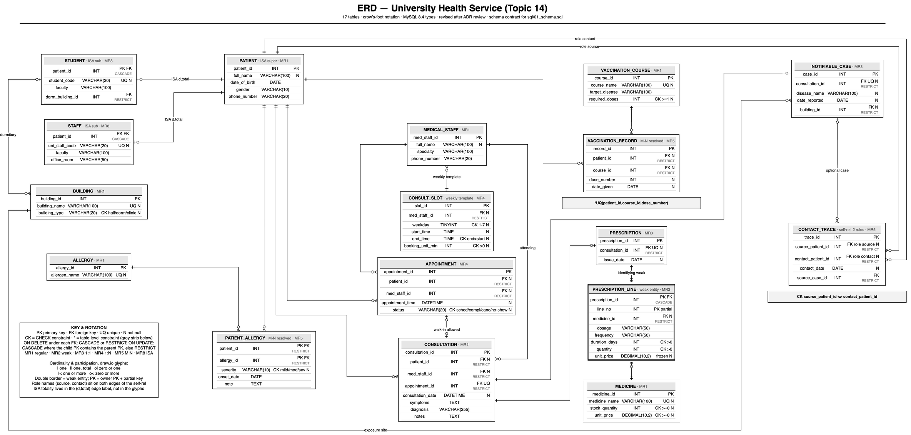

<!-- SUBMITTED — frozen. D2 was submitted on 11/10/2026 at 22:30. Current facts live in docs/t19-query-verification.md, docs/deliverables-detail.md, and sql/03_queries_completed.sql. Do not edit this snapshot. -->

<!-- GOOGLE DOCS CONVERSION INSTRUCTION: Format this exact content as a five-page-or-fewer A4 report, including the cover. The final output must not spill onto a sixth page. Use 0.5-inch margins, 9-point body text, 7.5-point table text, compact paragraph spacing, and a real page break after the Cover Page. Keep the member list entirely on the cover page. Use one consistent heading hierarchy (Title → Heading 1 for numbered sections → Heading 2 for subsections) and one font family throughout (Times New Roman). Do not add, remove, or substantively rewrite content. -->

<!-- TEAM FINAL CHECK (before conversion): 1) Open the live allocation sheet and verify every name in the Owner columns of Sections 2.3 and 5 against the Người làm column. 2) If the query non-emptiness check closes tonight and all 12 queries are verified, upgrade the wording in Sections 5.3 and 5.5 to "All 12 queries verified non-empty" — until then keep the current wording exactly as written. 3) If the ER-checklist and schema reviews close tonight, move those two ledger rows to Done. 4) Verify instructor name, topic number, and group number on the cover — these were the most common Proposal deductions. -->

VIETNAM NATIONAL UNIVERSITY — HO CHI MINH CITY\
INTERNATIONAL UNIVERSITY\
**SCHOOL OF COMPUTER SCIENCE AND ENGINEERING**

# MIDTERM PROGRESS REPORT FOR TOPIC 14

## UNIVERSITY HEALTH SERVICE

**Course:** IT079IU – Principles of Database Management\
**Project topic:** Topic 14 — University Health Service\
**Group:** 2\
**Instructor:** Assoc. Prof. Dr. Nguyen Thi Thuy Loan\
**Semester:** 1, Academic Year 2026–2027\
**Submission deadline:** 11 October 2026, 22:30

## GROUP 2 — MEMBER LIST

| No. | Member | Student ID | Phone | Role | Topic |
|--|:----------------------|:-------------|:--------|:--------------------------|:-----------------------|
| 1 | Nguyễn Hiền Minh | ITITWE25011 | 0919150220 | Team Leader | 14 — University Health Service |
| 2 | Lê Thành Trung | ITCSIU25055 | 0359186887 | Team Member — Query developer | 14 — University Health Service |
| 3 | Nguyễn Trần Quốc Vinh | MAMAIU25041 | 0837991399 | Team Member — Java developer | 14 — University Health Service |
| 4 | Phan Nguyên Vũ | ITITIU25047 | 0945719666 | Team Member — Java developer | 14 — University Health Service |
| 5 | Nguyễn Hoàng Thiên Tứ | ITDSIU25050 | 0374749542 | Team Member — Query developer | 14 — University Health Service |
| 6 | Nguyễn Quốc Duy Lộc | ITITIU25018 | 0906648951 | Team Member — Data modeller | 14 — University Health Service |
| 7 | Trần Pham Quốc Nam | ITCSIU25037 | 0375314749 | Team Member — Database developer | 14 — University Health Service |
| 8 | Lê Đức Phát | ITCSIU25042 | 0767393239 | Team Member — Database developer | 14 — University Health Service |
| 9 | Nguyễn Minh Khôi | SESEIU24013 | 0902305920 | Team Member — Tester & Writer/Integrator | 14 — University Health Service |
| 10 | Lê Thảo My | SESEIU23018 | 0835931468 | Team Member — Normalization lead | 14 — University Health Service |
| 11 | Nguyễn Trần Anh Tuấn | SESEIU24030 | 0972235718 | Team Member — Normalization lead | 14 — University Health Service |
| 12 | Nguyễn Trọng Đức | ITITIU25003 | 0775327007 | Team Member — Data modeller | 14 — University Health Service |

## 2. Updated Information

Revisions since the proposal (submitted 27/9/2026). Sections 2.1 and 2.2 revise the design and the tooling; 2.3 updates the task allocation.

### 2.1 Design revisions

- **New business rule on demographics** — Patient demographics (full name, date of birth, gender, phone) are recorded once on Patient and inherited by both subtypes.
- **New business rule on prescription pricing** — The unit price on a prescription line is frozen at order time; the current medicine price never overwrites history.
- **Building type CHECK widened** — lab, pharmacy, and admin were added to the CHECK constraint; the original three values (hall/dorm/clinic) were too narrow for a university campus.
- **NotifiableCase 1:1 changed to 1:N** — the UNIQUE constraint on the consultation reference was dropped: each notifiable case derives from exactly one consultation, which is many-to-one, not one-to-one.
- **ER diagram and draft schema aligned** — diagram names are authoritative (medical-staff id, university staff code, booking unit in minutes); the Prescription carries no redundant doctor column; every foreign key states both its ON DELETE and ON UPDATE action. These decisions are recorded in the project's architecture decision records.

### 2.2 Tools update

The pinned stack is unchanged (JDK 25 LTS, Swing, JDBC, Connector/J 8.4.x, Maven 3.9.x, MySQL 8.4 LTS, draw.io). One addition: day-to-day verification runs on TiDB v8.5.3 cloud (MySQL-compatible); the target database remains MySQL 8.4 LTS, and the full script set is re-verified on MySQL 8.4 before the final report. The index, view, and transaction demo of Section 5.4 was already verified on MySQL 8.4.

### 2.3 Updated task allocation and W3–W5 progress

The live allocation sheet (owner, reviewer, deadline, priority, and evidence link for all 31 tasks) is at <https://docs.google.com/spreadsheets/d/1aK9sBoS4vLbmFEiUzMBYHttklbzfKpBDz51cXHGFQ4M/edit?usp=sharing>. Status at this report: **8 done, 1 in progress, 2 awaiting review, 20 upcoming**.

| Work item (W3–W5) | Role | Owner | Due | Status |
|---|---|---|---|---|
| Compile team list of 12 members | Group leader | Nguyễn Hiền Minh | 25/09 | Done |
| Business rules v1.1 (18 numbered rules) | Data modeller | Nguyễn Quốc Duy Lộc | 28/09 | Done |
| Team meeting: ratify rules | Group leader | Nguyễn Hiền Minh | 29/09 | Done |
| Entity list, stakeholder notes, and plan | Data modeller | Nguyễn Trọng Đức | 28/09 | Done |
| Assemble and submit the proposal | Group leader | Nguyễn Hiền Minh | 27/09 | Done |
| Draw ER draft on draw.io | Data modeller | Nguyễn Quốc Duy Lộc | 02/10 | Done |
| ER review against the required-construct checklist | Data modeller | Nguyễn Trọng Đức (reviewer: Lê Thành Trung) | 06/10 | Awaiting review |
| Draft schema and per-table mapping rule | Data modeller | Nguyễn Trọng Đức | 08/10 | Awaiting review |
| Functional-dependency document and normalization draft | Normalization lead | Lê Thảo My | 08/10 | Done |
| Assemble and submit this midterm report | Group leader | Nguyễn Hiền Minh | 11/10 | In progress |
| View, index, and two-table transaction | Query developer | Lê Thành Trung | 02/10 | Done |
| Verify all 12 queries return non-empty | Query developer | Lê Thành Trung | 05/11 | In progress |

Upcoming milestones, by owner: Lê Thảo My and Nguyễn Trần Anh Tuấn — functional-dependency minimal-cover proofs and 3NF/BCNF conclusions (25–28/10, for the normalization chapters of the final report); Trần Pham Quốc Nam and Lê Đức Phát — finalized schema script with run-twice test (25–27/10) and sample data of at least 15 rows per table (01/11); Lê Thành Trung and Nguyễn Hoàng Thiên Tứ — the 12 SQL statements with English question comments (01/11) and four relational-algebra versions (03/11); Nguyễn Trần Quốc Vinh and Phan Nguyên Vũ — the Swing screens (27/10–07/11); Nguyễn Minh Khôi — data-quality test and screenshots (09–10/11); Nguyễn Hiền Minh — final assembly (16/11) and demo rehearsal (Nov–Dec).

## 3. Table of Contents

1. Cover Page
2. Updated Information — 2.1 Design revisions · 2.2 Tools update · 2.3 Task allocation and progress
3. Table of Contents
4. Database Design — 4.1 ER Diagram · 4.2 Draft Schema · 4.3 Mapping Rules · 4.4 Functional Dependencies and Candidate Keys
5. Implementation Progress vs Plan — 5.1 Schema · 5.2 Sample data · 5.3 Queries · 5.4 Index, view, transactions · 5.5 Verification results
6. Known Gaps and Next Steps
Appendix A — AI-Use Disclosure

## 4. Database Design

### 4.1 ER Diagram

Files: UHS-ERD.drawio (source) and UHS-ERD.png (rendered diagram below), finalized with the schema alignment of Section 2.1.

17 entities, 21 relationships, crow's-foot notation, MySQL 8.4 attribute types, cardinality and participation marked on every edge.

| Required construct | Where |
|---|---|
| Weak entity with partial key | PrescriptionLine (line number) |
| Many-to-many relationship with own attributes | PatientAllergy (severity, onset date) |
| ISA hierarchy, disjoint and total | Patient → Student / Staff |
| Self-relationship with two role names | ContactTrace (source / contact) |
| Cardinality and participation | All 21 relationships |

Design decisions worth naming. **Medical staff are kept separate from patients** — one human may hold one unlinked record in each, and the medical-staff identifier always denotes the staff table, never the staff subtype of Patient. **A prescription carries no doctor column** — the prescriber is read through the visit's consultation, so an order and its visit can never disagree about who prescribed. **A consultation slot is a weekly template** — the booking unit is the bookable increment inside the window, not the window's length. **The exposure building of a notifiable case drives the 14-day cluster**, not the patient's dormitory.

### 4.2 Draft Schema

File: sql/01_schema.sql — 17 tables. Every table declares a primary key, foreign keys with explicit ON DELETE and ON UPDATE actions, NOT NULL, UNIQUE, CHECK, and DEFAULT constraints where appropriate. The script drops and recreates the database and runs twice in a row without manual repair.

Referential-action policy: ON DELETE CASCADE only where the child key contains the parent key (the Student and Staff subtypes follow Patient; prescription lines follow the prescription); ON DELETE RESTRICT everywhere else, so a booking, visit, or outbreak record can never vanish with its parent.

### 4.3 Mapping Rules

| Code | Rule | Tables |
|:-----|:---------------------------|:-------------------------------------|
| MR1 | Regular entity → table | Building, Patient, Allergy, MedicalStaff, Medicine, VaccinationCourse, ConsultSlot, Appointment |
| MR2 | Weak entity → table with owner key and partial key | PrescriptionLine |
| MR3 | One-to-one relationship → table with UNIQUE on the foreign key | Prescription, NotifiableCase |
| MR4 | One-to-many relationship → foreign key on the many side | ConsultSlot, Appointment, Consultation |
| MR5 | Many-to-many relationship → associative table | PatientAllergy, VaccinationRecord, ContactTrace |
| MR8 | ISA hierarchy → child key is also a foreign key to the parent | Student, Staff |

(MR codes follow the standard Elmasri–Navathe mapping algorithm.)

### 4.4 Functional Dependencies and Candidate Keys

Every relation's functional dependencies, minimal cover, and candidate keys are documented; the summary:

| Table | Candidate keys | Table | Candidate keys |
|---|---|---|---|
| Building | {building_id}, {building_name} | Appointment | {appointment_id} |
| Patient | {patient_id} | Consultation | {consultation_id}, {appointment_id} |
| Allergy | {allergy_id}, {allergen_name} | VaccinationRecord | {record_id}, {patient_id, course_id, dose_number} |
| MedicalStaff | {med_staff_id} | Prescription | {prescription_id}, {consultation_id} |
| Medicine | {medicine_id}, {medicine_name} | NotifiableCase | {case_id} |
| VaccinationCourse | {course_id}, {course_name} | PrescriptionLine | {prescription_id, line_no} |
| Student | {patient_id}, {student_code} | ContactTrace | {trace_id} |
| Staff | {patient_id}, {uni_staff_code} | ConsultSlot | {slot_id} |
| PatientAllergy | {patient_id, allergy_id} | | |

Every dependency's left-hand side is a candidate key, so **all 17 relations are in BCNF** and no decomposition is needed. The formal minimal-cover and losslessness proofs are scheduled for 25–28/10, feeding the normalization chapters of the final report.

## 5. Implementation Progress vs Plan

Ahead of the final-milestone deadline, the SQL implementation is drafted and partially verified.

### 5.1 Schema

The schema script (sql/01_schema.sql) defines 17 tables with all six constraint kinds enforced in the database itself — constraints enforced only in Java score nothing per the guideline. Executed twice consecutively on the cloud development database without manual repair.

### 5.2 Sample data

The data script (sql/02_data.sql) contains one INSERT block per table, 17 tables in total, at least 15 realistic rows each (30 patients, all others 15–16).

### 5.3 Queries

The query script (sql/03_queries.sql) holds 12 statements, each preceded by its English question comment: patient visit history across five tables (inner joins), doctor free slots (outer join), top-5 diagnoses (GROUP BY/HAVING), patients with all vaccination doses completed (NOT EXISTS, the for-all pattern), the same disease in one building within fourteen days (self-join), allergy detail per patient, doctors never booked, high-risk allergies (HAVING), nested EXISTS, a set operation, a patient-summary view, and an out-of-stock check. Four of them also have relational-algebra versions. The visit-history, top-diagnosis, full-dose, and fourteen-day-cluster queries are verified against the cloud database with non-empty samples; the remaining statements are under the final non-emptiness check (owner: Lê Thành Trung).

### 5.4 Index, view, and transactions

- **Index:** an index on Appointment(med_staff_id, appointment_time) — serves the doctor free-slot query above.
- **View:** a patient summary view joining Patient with its Student/Staff subtype.
- **Transactions:** two demos — a ROLLBACK case (a failed foreign-key insert shows both tables moved together) and a COMMIT case (a successful two-table insert). All three were verified live on MySQL 8.4.

### 5.5 Verification results

- Schema and data scripts run twice in a row on TiDB v8.5.3 (MySQL-compatible) without errors or manual repair.
- All 17 tables hold at least 15 rows; the four key queries listed in 5.3 return non-empty results.
- The index, view, and transaction demo was verified on MySQL 8.4.

## 6. Known Gaps and Next Steps

- **This week:** close the pending ER checklist review and schema/mapping review; complete the non-emptiness check for all 12 queries; re-run the index/view/transaction verification on MySQL 8.4 after the recent schema renames.
- **Open modelling items:** three participation minima on the ER diagram have no backing business rule yet, and per-element rule tags are not yet drawn on the diagram. Both are resolved before the final report.
- **W6–W10:** functional-dependency proofs (Lê Thảo My, Nguyễn Trần Anh Tuấn), final schema and data scripts on MySQL 8.4 (Trần Pham Quốc Nam, Lê Đức Phát), 12 verified queries plus relational algebra (Lê Thành Trung, Nguyễn Hoàng Thiên Tứ), Swing application (Nguyễn Trần Quốc Vinh, Phan Nguyên Vũ), integration testing and report assembly (Nguyễn Minh Khôi, Nguyễn Hiền Minh).

## Appendix A — AI-Use Disclosure

Substantial AI assistance was used to generate this report's Markdown from the course brief, the submission guideline, the approved proposal, the project's decision records and business rules, the live allocation sheet, and the SQL files. During drafting, generated content was checked against the course assignment specification, the live progress sheet, and the actual repository files; claims of verification were kept only where an execution had actually been run, and the query status reflects the file state at writing time, not the target state. Before submission, the group performs a final academic and technical review and ensures every member can explain the design. Google Gemini is used only to convert the approved Markdown into Google Docs and PDF; the converted document is compared against this Markdown and any changed wording is corrected before submission.
