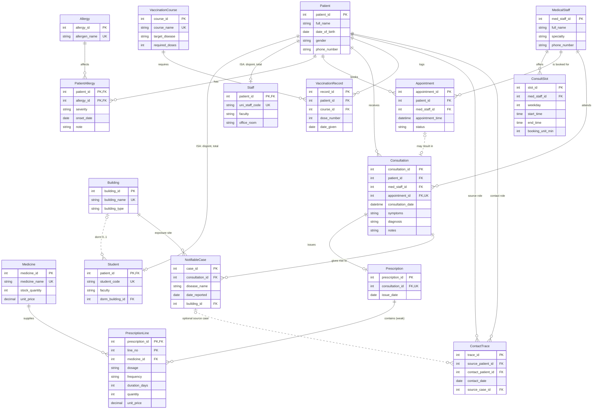

# Relational Schema — University Health Service (Topic 14)

- **Owner:** R2 — Data Modeller
- **Contract:** aligned with `sql/01_schema.sql`, `docs/er/UHS-ERD.drawio` and ADR-17 (17 relations, 21 foreign keys).
- **Convention:** CamelCase table names, snake_case column names, `MR*` mapping codes.

This file is the single source of truth for the relational schema and the
mapping rules. It replaces the former draft-schema and mapping-rules files.

## 1. Legend

- <u>ColumnName</u>: primary key (PK).
- ***ColumnName***: primary key and foreign key (PK and FK).
- `ColumnName*`: foreign key (FK).
- `[UQ]`: unique constraint. `[NN]`: NOT NULL constraint.
- A column without `[NN]` is nullable.

## 2. Relational diagram

The diagram below shows the 17 relations and their 21 foreign-key
relationships. A solid line marks an identifying relationship: the child key
contains the parent key, so the child cannot exist without its owner. A dashed
line marks a non-identifying relationship. `PK`, `FK` and `UK` mean primary key,
foreign key and unique key. The diagram is generated from the same contract as
`sql/01_schema.sql`, so it stays in step with the DDL.

## 3. Relations by functional group

### Group 1 — independent tables and core demographics

1. `Building` (<u>building_id</u>, building_name [UQ, NN], building_type [NN])
   - CHECK: `building_type IN ('hall', 'dorm', 'clinic', 'lab', 'pharmacy', 'admin')`.
2. `Patient` (<u>patient_id</u>, full_name [NN], date_of_birth, gender, phone_number)
3. `Allergy` (<u>allergy_id</u>, allergen_name [UQ, NN])
4. `MedicalStaff` (<u>med_staff_id</u>, full_name [NN], specialty, phone_number)
5. `Medicine` (<u>medicine_id</u>, medicine_name [UQ, NN], stock_quantity [NN], unit_price [NN])
   - DEFAULT: `stock_quantity = 0`; CHECK: `stock_quantity >= 0`, `unit_price >= 0`.
6. `VaccinationCourse` (<u>course_id</u>, course_name [UQ, NN], target_disease, required_doses [NN])
   - CHECK: `required_doses >= 1`.

### Group 2 — ISA hierarchy

7. `Student` (<u>*patient_id*</u>, student_code [UQ, NN], faculty, dorm_building_id*)
   - FK `patient_id` -> `Patient(patient_id)`: ON DELETE CASCADE, ON UPDATE CASCADE.
   - FK `dorm_building_id` -> `Building(building_id)`: ON DELETE RESTRICT, ON UPDATE RESTRICT.
   - `dorm_building_id` is nullable (`0..1`): a day student boards nowhere (ADR-17).
8. `Staff` (<u>*patient_id*</u>, uni_staff_code [UQ, NN], faculty, office_room)
   - FK `patient_id` -> `Patient(patient_id)`: ON DELETE CASCADE, ON UPDATE CASCADE.

### Group 3 — schedules, encounters and prescriptions

9. `ConsultSlot` (<u>slot_id</u>, med_staff_id* [NN], weekday [NN], start_time [NN], end_time [NN], booking_unit_min [NN])
   - FK `med_staff_id` -> `MedicalStaff(med_staff_id)`: ON DELETE RESTRICT, ON UPDATE RESTRICT.
   - CHECK: `weekday BETWEEN 1 AND 7`, `end_time > start_time`, `booking_unit_min > 0`.
10. `Appointment` (<u>appointment_id</u>, patient_id* [NN], med_staff_id* [NN], appointment_time [NN], status [NN])
    - FK `patient_id` -> `Patient(patient_id)`: ON DELETE RESTRICT, ON UPDATE RESTRICT.
    - FK `med_staff_id` -> `MedicalStaff(med_staff_id)`: ON DELETE RESTRICT, ON UPDATE RESTRICT.
    - DEFAULT: `status = 'scheduled'`; CHECK: `status IN ('scheduled', 'completed', 'cancelled', 'no-show')`.
11. `Consultation` (<u>consultation_id</u>, patient_id* [NN], med_staff_id* [NN], appointment_id*, consultation_date [NN], symptoms, diagnosis, notes)
    - FK `patient_id` -> `Patient(patient_id)`: ON DELETE RESTRICT, ON UPDATE RESTRICT.
    - FK `med_staff_id` -> `MedicalStaff(med_staff_id)`: ON DELETE RESTRICT, ON UPDATE RESTRICT.
    - FK `appointment_id` -> `Appointment(appointment_id)`: ON DELETE RESTRICT, ON UPDATE RESTRICT.
    - UNIQUE (`appointment_id`): one appointment links to at most one consultation.
12. `Prescription` (<u>prescription_id</u>, consultation_id* [UQ, NN], issue_date [NN])
    - FK `consultation_id` -> `Consultation(consultation_id)`: ON DELETE RESTRICT, ON UPDATE RESTRICT.
13. `PrescriptionLine` (<u>*prescription_id*, line_no</u>, medicine_id* [NN], dosage, frequency, duration_days, quantity, unit_price [NN])
    - Weak entity: composite PK with `line_no` as the partial key.
    - FK `prescription_id` -> `Prescription(prescription_id)`: ON DELETE CASCADE, ON UPDATE CASCADE.
    - FK `medicine_id` -> `Medicine(medicine_id)`: ON DELETE RESTRICT, ON UPDATE RESTRICT.
    - CHECK: `duration_days > 0`, `quantity > 0`; `unit_price` is the price frozen at order time (BR-20).

### Group 4 — allergies, immunization and outbreak tracing

14. `PatientAllergy` (<u>*patient_id*, *allergy_id*</u>, severity [NN], onset_date, note)
    - M:N associative entity. Severity belongs to the pair, not to either parent.
    - FK `patient_id` -> `Patient(patient_id)`: ON DELETE RESTRICT, ON UPDATE RESTRICT.
    - FK `allergy_id` -> `Allergy(allergy_id)`: ON DELETE RESTRICT, ON UPDATE RESTRICT.
    - CHECK: `severity IN ('mild', 'moderate', 'severe')`.
15. `VaccinationRecord` (<u>record_id</u>, patient_id* [NN], course_id* [NN], dose_number [NN], date_given [NN])
    - FK `patient_id` -> `Patient(patient_id)`: ON DELETE RESTRICT, ON UPDATE RESTRICT.
    - FK `course_id` -> `VaccinationCourse(course_id)`: ON DELETE RESTRICT, ON UPDATE RESTRICT.
    - UNIQUE (`patient_id`, `course_id`, `dose_number`); CHECK: `dose_number >= 1`.
16. `NotifiableCase` (<u>case_id</u>, consultation_id* [NN], disease_name [NN], date_reported [NN], building_id* [NN])
    - FK `consultation_id` -> `Consultation(consultation_id)`: ON DELETE RESTRICT, ON UPDATE RESTRICT.
    - FK `building_id` -> `Building(building_id)`: ON DELETE RESTRICT, ON UPDATE RESTRICT. The building is the exposure site for the 14-day cluster (BR-16).
17. `ContactTrace` (<u>trace_id</u>, source_patient_id* [NN], contact_patient_id* [NN], contact_date [NN], source_case_id*)
    - Self-referencing entity with two roles: source and contact (ADR-06).
    - FK `source_patient_id` -> `Patient(patient_id)`: ON DELETE RESTRICT, ON UPDATE RESTRICT.
    - FK `contact_patient_id` -> `Patient(patient_id)`: ON DELETE RESTRICT, ON UPDATE RESTRICT.
    - FK `source_case_id` -> `NotifiableCase(case_id)`: ON DELETE RESTRICT, ON UPDATE RESTRICT.
    - CHECK: `source_patient_id <> contact_patient_id`.

## 4. Mapping rules and matrix

| Code | Mapping technique | Tables |
|---|---|---|
| **MR1** | Regular entity -> independent table with its own PK. | `Building`, `Patient`, `Allergy`, `MedicalStaff`, `Medicine`, `VaccinationCourse` |
| **MR2** | Weak entity -> composite PK of owner PK plus partial key; owner FK uses CASCADE. | `PrescriptionLine` |
| **MR3** | 1:1 relationship -> FK with UNIQUE on the child side. | `Prescription` |
| **MR4** | 1:N relationship -> FK placed on the N side. | `ConsultSlot`, `Appointment`, `Consultation`, `VaccinationRecord`, `NotifiableCase` |
| **MR5** | M:N associative or recursive entity -> junction table with relationship attributes. | `PatientAllergy`, `ContactTrace` |
| **MR8** | ISA hierarchy -> subtype PK is also FK to the supertype, with CASCADE. | `Student`, `Staff` |

The `MR*` codes replace the earlier `R1..R8` tags, which collided with the D1
role codes `R1..R7`. Diagram: `docs/er/UHS-ERD.drawio`. Checklist: `docs/er/er-checklist-review.md`.
